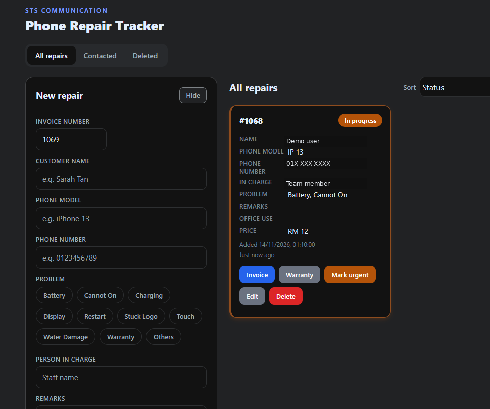
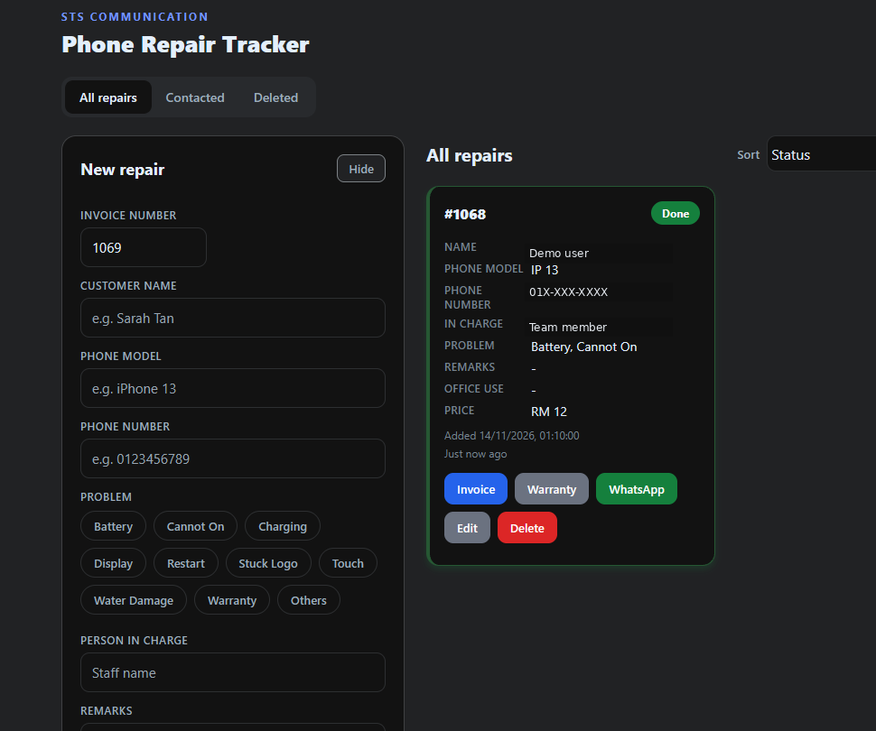
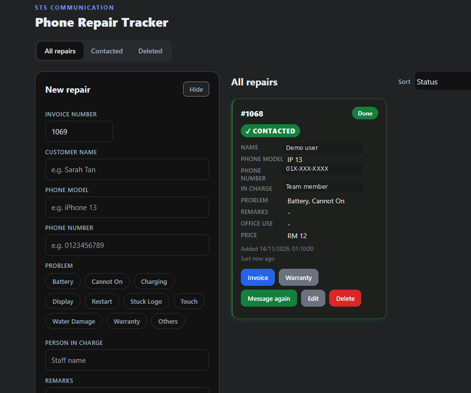
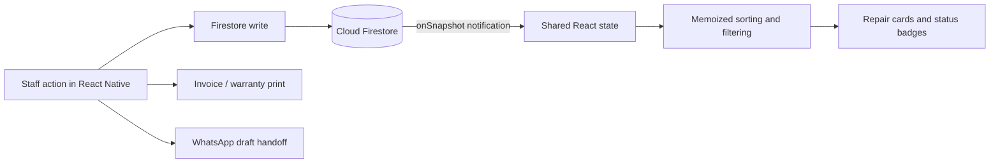
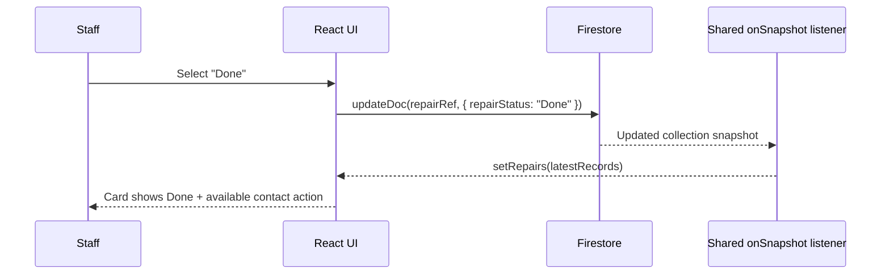

# Phone Repair Tracker

**An internally deployed repair-management system built for a family-owned phone repair business.**  
**Role:** Independent developer  
**Stack:** JavaScript · React Native · React Hooks · Firebase Cloud Firestore · WhatsApp deep links

> **Portfolio case study:** This is a real application used in day-to-day business operations. The production database, customer records and complete operational source code are intentionally not published. Identifying information has been masked in the included screenshots. No performance or cost-saving figures are claimed without measurement.

## Overview

The business needed a central place to record incoming repairs, track their progress and prepare customer communication without repeatedly checking separate lists. I designed and built **Phone Repair Tracker** to support that workflow in a responsive, card-based interface backed by Firestore.

The main engineering focus was keeping the interface in sync with the database **without creating a separate database listener for every repair card or relying on repeated polling requests**.

## Application screenshots

### 1. Repair intake and active jobs



The intake form captures device model, reported issues, staff assignment, contact details, notes and estimated price. Each repair has a status and quick actions.

### 2. Completed repair



Once a repair is marked **Done**, the card reflects the updated status and offers the staff-initiated WhatsApp handoff alongside the invoice and warranty actions.

### 3. Customer contacted



After staff choose the contact action, the app records a `contacted` flag and shows a visible indicator; it can also open a prefilled WhatsApp draft. **The application does not automatically send WhatsApp messages.**

## Features

| Feature | Implementation |
| --- | --- |
| Repair intake and editing | Create or update a repair with issue categories, internal notes, assigned staff and estimated price |
| Live tracking | Firestore listeners keep the active and deleted repair lists synchronised |
| Workflow states | `In Progress`, `To Be Confirmed`, `Done` and `FOC` |
| Priority management | Urgent markers, elapsed-time tracking, overdue indicators and snooze controls |
| Customer communication | Pre-populated WhatsApp message with an explicit staff handoff and a persisted `contacted` flag |
| Documents | Browser-printable repair invoices and warranty slips, with configurable warranty duration |
| Record lifecycle | Archive, restore and delete views; age-based archive and purge routines are implemented |
| Usability | Status/date/invoice sorting, *All repairs / Contacted / Deleted* tabs, responsive layout and adjustable card size |

## How it works



The main collections referenced by the application are:

- `repairs` — active repair records.
- `deleted_repairs` — archived records that can be viewed or restored.
- `settings/invoiceCounter` — document used to track the next invoice number.

### Engineering focus: event-driven Firestore listeners

A common source of unnecessary work in real-time dashboards is allowing each card, tab or form to independently subscribe to the same data. I avoided that pattern by defining **two collection-level subscriptions in one mount-time `useEffect`**: one for active repairs and one for archived repairs.

The following is a shortened extract of the actual listener pattern:

```jsx
useEffect(() => {
  const unsubRepairs = onSnapshot(
    collection(db, 'repairs'),
    snapshot => setRepairs(
      snapshot.docs.map(doc => ({ id: doc.id, ...doc.data() }))
    ),
    error => console.error('repairs listener error:', error)
  );

  const unsubDeleted = onSnapshot(
    collection(db, 'deleted_repairs'),
    snapshot => setDeletedRepairs(
      snapshot.docs.map(doc => ({ id: doc.id, ...doc.data() }))
    ),
    error => console.error('deleted_repairs listener error:', error)
  );

  return () => {
    unsubRepairs();
    unsubDeleted();
  };
}, []);
```

**Why this design matters:**

1. **Subscribe once, not per card.** The two listeners are created when the component mounts. Opening a different tab or rendering another card does not create additional Firestore subscriptions.
2. **Database-driven updates, not polling.** Firestore sends snapshot notifications when the subscribed data changes. The app doesn't repeatedly run a database query every few seconds just to look for status changes.
3. **One shared source of truth.** Incoming snapshots populate `repairs` and `deletedRepairs`. The cards read from this shared state instead of querying the database themselves.
4. **Clean teardown.** The `onSnapshot` functions return unsubscribe callbacks, called when the component unmounts. This avoids leaving listeners alive after the screen is removed.
5. **Separate database work from local UI work.** Switching tabs, changing sort order or resizing cards operates on the already-loaded records; those interactions don't initiate fresh Firestore reads in this implementation.

### What happens when a status changes?

For example, when a staff member changes a repair from *In Progress* to *Done*:



The Firestore write handler uses `updateDoc`. The **listener** is responsible for reflecting the resulting database state in the interface, so each action does not require a separate manual fetch of the entire list.

### Client-side memoization

The app also uses React's `useMemo` to derive sorted and filtered lists:

```jsx
const sortedRepairs = useMemo(
  () => dedupeById(sortRepairs(repairs, sortOption)),
  [repairs, sortOption]
);

const contactedRepairs = useMemo(
  () => sortedRepairs.filter(repair => repair.contacted === true),
  [sortedRepairs]
);
```

This avoids re-running list transformations on unrelated renders when their dependencies have not changed. The same source list supports *All repairs*, *Contacted* and *Deleted* tabs without a query per tab.

For the overdue clock, a separate interval updates React state **once per minute**; this updates elapsed-time displays locally rather than polling Firestore for the current time.

**Important distinction:** The central-listener design reduces redundant *subscriptions*, and memoization reduces unnecessary *client-side computation*. It does **not** mean zero database reads or prove a specific percentage of cloud-cost savings. Firestore can still incur document reads for initial snapshots, reconnects and subsequent changes. This implementation also subscribes to whole collections and rebuilds arrays from snapshots, so server-side queries, pagination and incremental updates would be sensible next steps as the record count grows.

## Other implementation details

**Repair lifecycle.** A repair begins as `In Progress`; staff can update its status, set urgency, snooze an overdue item and mark a completed job as contacted. The app includes automatic time-based archiving and deletion routines for older records, plus a duplicate-cleanup function.

**Invoice numbering.** New repairs are saved to Firestore, and a `runTransaction` updates the invoice-counter document. The counter update itself is transactional. However, creating the repair and incrementing the counter are currently separate operations, so the full process is **not yet an atomic allocation of invoice numbers**.

**Printed documents.** Invoice and warranty layouts are generated as HTML and opened in a browser print window. They include repair details, the amount and, for warranties, a configurable warranty period.

**Customer communication.** The app builds a WhatsApp `wa.me` link with a prefilled completion message. A staff member chooses whether to send it; the application does not send messages unattended.

## What I built

I independently developed the application's interface, state-management logic and Firestore integration for use within the family business. That included the repair form, status workflow, live data listeners, sorting and filtering, invoice/warranty printing, contact handoff and responsive repair-card layout.

Unlike a class assignment, this project is **actively used in business operations**. I have not included unverified user counts, processing volumes or productivity figures.

## Current limitations and planned improvements

This project is presented as working internal software, **not as an audited enterprise product**:

- **Archiving reliability:** The current archive flow deletes the active document before writing its archived copy. If the second operation fails, the record could be lost. A transaction/batch or a recoverable archive-first process would be safer.
- **Atomic invoice creation:** Include the record write and number allocation in one consistent transaction, or use a server-controlled allocation process.
- **Subscription scalability:** Whole-collection listeners are simple for an internal dashboard, but filtered queries, pagination and appropriate indexes may reduce read/transfer costs at larger scale.
- **Security:** Authentication, access control and Firestore security rules must be reviewed before any external access. Customer contact information and internal notes must never be exposed in a public demo.
- **Rendering and maintainability:** Incremental `docChanges()` processing, smaller components and automated tests would help as the application expands.
- **Print safety:** Data inserted into HTML templates should be escaped or rendered safely to avoid injecting markup from user-supplied fields.

## Repository disclosure

This repository is intended as a **public technical case study**. It does not contain the production Firestore database, real customer records or confidential business assets. Screenshots have identifying details obscured; the business owner should approve public use of the application name or branding. The production source can remain private.

If an authorised demonstration becomes available, a separate demo environment with synthetic data can be linked here.
